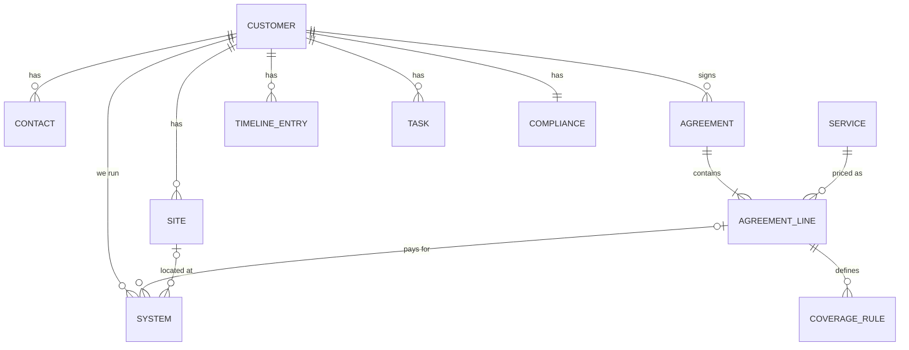
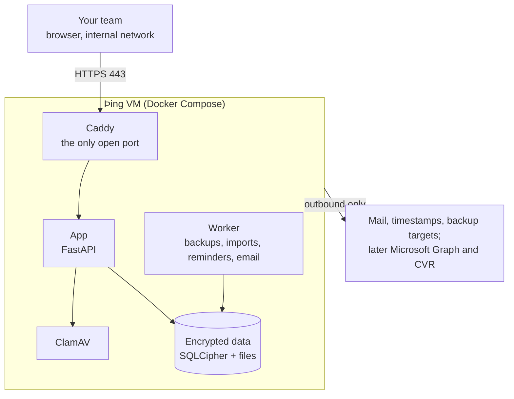

# Þing architecture

This document describes how Þing is designed. It is the reference for contributors and is updated as the design changes.

Þing is a sister product to [Skjald](https://github.com/FragmentedCoder/Skjald-Reporting), the report builder, and started from Skjald's platform at commit `a768d1b` (its Phase 1: installer, setup wizard, sign-in with MFA, roles, customers, keys, audit log, backups). The repository keeps Skjald's history, so platform fixes can move across. The two are separate products: Þing has its own repository, database, users and install, and shares no accounts or data with Skjald. The sections on the security model, deployment and releases describe that inherited platform as it runs today; [Inherited from Skjald](#inherited-from-skjald) lists what Phase 1 still changes. Phase 0 is in progress; see the roadmap at the end.

## Principles

- **Technicians first.** When a customer calls, a technician answers three questions in seconds: what the customer pays for, whether this task is covered by their agreement or billable, and which systems we run for them. Sales and management views come later, on the same data.
- **Overview first.** The most important information is visible at a glance; details are one click away. White and simple: neutral surfaces, colour only for status and the one accent, borders rather than shadows.
- **One company per install.** No multi-tenancy. Another company runs its own install.
- **Internal network only.** Nothing in Þing faces the internet; integrations are outbound only.
- **Security first.** Per-customer encryption keys, MFA for every account, need-to-know access by customer assignment and a tamper-evident audit log. The engineering baseline is OWASP ASVS Level 2. Þing holds personal data about customer contacts, and the company holds the Danish D-mærket and has NIS2 customers, so views, exports, imports and deletions are logged.
- **No secrets.** Þing never stores passwords, OTP secrets or keys for customer systems. Devolutions Remote Desktop Manager is the secret store; a system in Þing holds a reference to its RDM entry.
- **Þing is the source of truth for agreements.** No accounting or PSA system holds what each customer pays, so Þing owns agreements, agreement lines and prices. It does not do invoicing or time registration.
- **Retention from the start.** Retention and deletion rules per customer are part of the data model, not added later.
- **Easy to install.** One command on a fresh Ubuntu Server LTS VM, plus a verifiable install path.

## What Þing is for

The name follows the *þing*, the Norse assembly in a ring of standing stones. The tagline, *Gather. Agree. Remember.*, follows the three parts of the product:

| Tagline word | Part of the product |
| --- | --- |
| **Gather** | Customers, sites, contacts, the systems we run |
| **Agree** | Agreements, what they pay for, what is covered, renewals |
| **Remember** | Timeline of calls, meetings, notes and tasks (later mail); compliance records |

Users in v1 are the technicians, an Administrator and an Auditor. Everyday situations Þing must make fast:

1. **The phone rings.** The technician searches by company name, CVR number, contact name, phone number or email domain. The customer page opens on an overview: what they pay for, what is covered, pinned warnings, the latest notes. The technician checks coverage (*Covered*, *Billable* or *Not covered*, with the rule text) and logs the call on the timeline in a few clicks.
2. **Something we manage breaks.** The technician opens the system (firewall, server, Microsoft 365 tenant). It shows the agreement line that pays for it, the SLA response time, its site, and a link to its entry in RDM. A system that **no agreement line pays for** is flagged, because that is unbilled work.
3. **Before an on-site visit.** Sites, the systems at that site, the on-site contacts, open tasks and recent notes are on one screen.
4. **Agreements need attention.** The home screen lists notice deadlines and renewals coming up, and agreements that have ended while systems still point at them.
5. **A NIS2 customer asks for supplier documentation.** The compliance tab shows their NIS2 class, data processing agreement status, review dates and what has been delivered.

The team tracks server updates in a spreadsheet today (Appendix A). That becomes a maintenance view on systems after 1.0; the system model leaves room for it.

## Scope

| | What |
| --- | --- |
| **v1** | Customers, sites and contacts · service catalog · agreements, agreement lines and coverage rules · systems we provide, with RDM references · timeline and tasks · global search · customer overview page · home overview · compliance tracking (NIS2 class, data processing agreement, reviews) · import from CSV/Excel |
| **After 1.0** | Microsoft 365 mail on the timeline (to confirm) · CVR lookup · reminders by email · maintenance and update tracking per system · sales role with pipeline and quotes · management role with revenue and renewals across customers |
| **Out of scope** | Storing passwords or other secrets · ticketing/PSA · invoicing · time registration · marketing · multi-tenancy |

## Data model



The key link is **System → Agreement line ("paid by")**. It is what lets a technician open a customer's firewall and see "covered by agreement 2026-014, line 3: firewall management; includes rule changes, excludes on-site visits".

| Entity | Main fields |
| --- | --- |
| **Customer** | Name, CVR, address, main phone, email domains (for search and later mail matching), status (prospect / active / former), account owner (a technician), NIS2 class, pinned notes, retention period, custom fields. Has its own encryption key. |
| **Site** | Name, address, access notes. |
| **Contact** | Name, title, roles (primary, technical, billing, decision-maker, security/NIS2 contact), email, phone, site, **may contact** (yes/no plus a note), preferred channel. |
| **Service** (catalog) | Name, category, description, default unit and price, **default coverage rules**. Shared by all customers. |
| **Agreement** | Number, type (service agreement, project, hourly), status (draft / active / ending / ended), start and end dates, notice period, renewal (automatic / manual), SLA level and response times, signed PDF, owner. |
| **Agreement line** | Service, description, quantity, unit, unit price (DKK), billing interval, start and end dates. |
| **Coverage rule** | Belongs to a line. Subject (a type of work or a system type), verdict (included / not included / limited), limit (for example 5 hours a month) and rule text. **Copied from the service's defaults when the line is created**, so later catalog changes never alter a signed agreement. |
| **System** | Type (server, firewall, switch, wireless, Microsoft 365 tenant, backup, …), name, site, vendor and model, serial number, host name/IP, role, status (active / retired), **paid by** (an agreement line; empty is flagged), **RDM reference** (never a credential). Room for later maintenance fields: updates itself, maintenance window, last maintenance, may update in working hours. |
| **Timeline entry** | Type (note, call, meeting, visit, email), date, author, body, linked contacts, systems or agreement, optional follow-up task. |
| **Task** | Title, due date, assignee, status, customer, linked entry. |
| **Compliance** | NIS2 class (essential / important / not covered / unknown), data processing agreement (status, signed date, next review), supplier documentation (requested and delivered dates), next security review. |
| **Attachment** | Encrypted with the customer's key, scanned with ClamAV, checked against the file type blocklist. |
| **User, role, assignment, audit event** | As in the platform (below). |

- **A customer is a sealed container**, as in Skjald: everything that says who the customer is or what we know about them (name, CVR, address, sites, contacts, agreements and their lines, systems, timeline, compliance and files) is sealed with the customer's key, each value bound to its record. Only IDs, numbers and what access needs (assignments, status, dates that drive the home screen) stay plain. The audit log names customers by ID, so deleting a customer leaves nothing readable behind. Which fields stay plain is decided per entity in Phase 2, and recorded here.
- **Search** opens the sealed fields of the customers the searcher may see and matches them in memory. At an MSP's scale (hundreds of customers, a few thousand contacts and systems) that takes milliseconds. If it ever doesn't, the fallback is a blind index: an HMAC of each normalised CVR number, phone number and email domain under a key wrapped by the master key.
- **Coverage in v1 is deliberately simple:** a structured verdict and limit plus free text, with no rules engine. Þing does not do time registration, so a "limited" rule shows the limit but not how much of it is used.
- **Prices** are DKK, stored as whole øre.

## Screens

- **Home ("Today")**: my open tasks and follow-ups; notice deadlines and renewals in the next 60 days; customers needing attention (compliance review due, data processing agreement missing, systems no agreement line pays for); recently viewed customers.
- **Customer page**, the heart of Þing:
  - **Header:** name, CVR, status, NIS2 class badge, primary contact and **pinned notes**: short warnings that must never be missed, such as "Do not update in working hours" or "Only contact the owner".
  - **Overview:** what they pay for (agreement lines, with the monthly total in DKK), a short coverage summary, the systems we run, the latest timeline entries and open tasks.
  - **Agreements and coverage:** agreements, lines, coverage rules, dates and the signed PDF.
  - **Systems:** each system with the line that pays for it, its site and the RDM link.
  - **Contacts and sites:** contacts with roles and the "may contact" flag, plus sites.
  - **Timeline:** calls, meetings, notes, visits, tasks (and mail later), filterable.
  - **Compliance:** NIS2 class, data processing agreement, review dates, supplier documentation delivered.
- **Coverage check:** from the customer page, pick a system or a type of work. Þing answers **Covered**, **Billable** or **Not covered**, with any limit ("Covered, up to 5 hours a month"), and quotes the rule text and the agreement line.
- **Agreements:** all agreements across customers, filterable by renewal or notice date, status and owner.
- **Admin:** users, roles, assignments, service catalog, custom fields, import, backups, audit log.

Global search opens on `Ctrl+K` or `/` from every screen. Labels are plain English in sentence case, and every status shows a word, never colour alone.

The app shell comes from Skjald: a side menu with Home and All customers first, then a customer picker and the open customer's sections, then Admin, with the account, light or dark, and Sign out at the bottom. The menu lists only what the person may open, refreshes the customers someone may see every minute while the page is in view, and takes a customer out of view at once when access ends. At phone width it slides in over the page. The browser remembers which customer was open by its ID only, never its name. The sign-in and setup pages show a fjord scene behind their card, light or dark with the page.

## Roles

| Role | When | Can |
| --- | --- | --- |
| Administrator | v1 | Everything: users, roles, assignments, service catalog, keys, backups, imports |
| Technician | v1 | Read and update the customers they're assigned to: contacts, sites, agreements, systems, timeline, tasks and compliance |
| Auditor | v1 | Read the audit log and record metadata |
| Sales | Later | Prospects, pipeline and quotes; read agreements |
| Management | Later | Revenue, renewals and coverage across all customers, read-only |

Access to customer data is assignment-based: Administrators see every customer, technicians see the customers they're assigned to, and a customer someone may not see answers 404, like one that doesn't exist, with the refusal logged. Routes ask for a capability (such as "administer" or "read the audit log"), never a role; `backend/app/roles.py` holds the one table of which roles grant which capability, and a test checks it against this table. A person can hold several roles, and every grant is logged with who made it.

The platform still has Skjald's roles today (Manager, Report Designer, Technician, Reviewer, Auditor, Administrator); Phase 1 replaces them with these.

### Administration

- **Users.** Administrators add people with their roles and business details. By default Þing makes a random one-time password (ASVS 6.4) that works for 7 days and must be replaced before the app opens; an administrator can type one instead, which has to pass the same rules and is still replaced at first sign-in unless they untick that. If the account already has multifactor, that is asked for first. Administrators edit details and roles; reset a password or multifactor (for a lost phone or key); unlock, disable or enable an account; and see and end its sessions, one at a time or all. Disabling ends every session at once. The users list has a menu on each row for these. They can't disable themselves or drop their own Administrator role, and the break-glass Administrator always keeps that role, stays active and needs multifactor, so an active Administrator always remains. Actions on yourself go through Your account.
- **Security settings.** Whether multifactor is required for everyone and for administrators (both on by default; ASVS Level 2 expects it for everyone), the password and session policy within fixed limits, and two IP allowlists, each with its own switch: one for signing in at all (off by default) and one for the admin panel. The admin panel allowlist only hides the panel: administrators elsewhere still sign in and work, but their Administrator role opens no part of the panel (the audit log included, unless they are Auditors too), so its link disappears. Both are enforced in the app, and the admin panel's at Caddy too; a list that would leave out the saver's own address is refused, and `ting admin reset-allowlist` on the VM switches both off. Lowering security needs a confirmation for that very change; other changes that can sign people out need a recent one (step-up, below).
- **Branding.** The site name, tag line and logo shown in the app and on the sign-in page (in the menu, the tag line goes under the name, and beside it, for people signed in, which Þing this is), the company name, and the site's primary and accent colours, which Administrators can enforce for everyone. People otherwise pick their own in Your account, from a short list whose every colour a test checks for WCAG AA contrast in light and dark mode; only the names are stored. For the site, Administrators can also pick any colour: the browser uses the nearest shade of it that passes the same checks (darker for light mode, lighter for dark mode), shows both before saving, and a test runs the shading over a spread of colours, the hard ones included. Logos and profile pictures are decoded and re-encoded as PNG (Pillow), which drops metadata and anything hidden in the file and scales them down; SVG isn't accepted, since it can carry scripts.
- **Server health.** The database's integrity check (`PRAGMA cipher_integrity_check`), the audit chain and its daily timestamps (with a button to timestamp now, and the timestamp authority to use), the key files, free disk space, whether Have I Been Pwned answers, and the server clock against the browser's (authenticator codes need it right); also space used and software versions down to each Python package. Each check is its own request, so the page fills in as they finish, each marked with a green check mark, a warning or a red cross. The Audit log page keeps one line saying whether the chain and its timestamps check out, for Auditors.
- **Audit log viewer.** Administrators and Auditors filter by action or group, person and dates, check the chain, and export CSV. Times are ISO 8601 in UTC, on the page (to the second) and in the export (to the microsecond, as stored). Exported cells that a spreadsheet would read as a formula are prefixed with `'` (CSV injection), and every export is itself logged. Listing pages by sequence number, so it stays fast however long the log grows; checking the chain re-hashes every entry, so it and the export read in a transaction that takes no write lock, and the export streams. Checkpoints that let a check start from the last verified entry come with the background worker.
- **Your account.** Display name and business details (first, middle and last name, job title, department, work email and phone; nothing private), a profile picture, appearance (system, light or dark, and colours, stored per user; a button at the bottom of the side menu switches light and dark; the change is instant, and only signing in and out fades slowly from one to the other), password with its rules spelled out, multifactor methods and recovery codes, and sessions, which can be signed out one at a time. Removing a method (never the last, while multifactor is required) and new recovery codes need the password again; a wrong one counts towards the lockout. Changing the password signs out every other session and gives this one a new token.

## Integrations

All integrations are outbound only; nothing reaches into Þing from outside.

- **Devolutions Remote Desktop Manager (v1).** A system holds a reference to its RDM entry or vault so the technician can jump there, never a credential. RDM opens entries from `rdm://` links (its release notes for 2026.3 fix a bug in them), so the reference will most likely be such a link plus the entry's name; Phase 2 confirms the link format against the team's Devolutions Cloud workspace before the field is built.
- **Import (v1).** CSV and Excel import for customers, contacts, sites and systems, with a mapping step and a dry run before anything is written. Imports run as worker jobs and are logged. The team's server update spreadsheet (Appendix A) is the likely first source; its free-text cells ("ja, server opdater selv.") need a review step.
- **Microsoft 365 mail (after 1.0, to confirm).** Microsoft Graph with an Entra app registration, limited to chosen mailboxes with Exchange RBAC for Applications rather than the whole tenant. Only mail to or from known customer contacts or domains is filed, encrypted with that customer's key.
- **CVR lookup (after 1.0).** Fills in name and address from a CVR number. The source is chosen with the user, after checking the terms of the official data distribution; results are cached.

## Security model

### Sign-in and sessions

- **Passwords** are hashed with Argon2id (RFC 9106's low-memory profile) after Unicode NFKC normalisation, so the same password typed on any keyboard matches. Administrators set the minimum length (default 12). There are no composition rules (upper case, digits, symbols): ASVS forbids them because they push people towards predictable patterns. A password may not contain the username or the product name ("þing" anywhere; "ting" or "thing" only as a word of its own, since "meeting" or "something" says nothing about the product), and is checked against Have I Been Pwned's Pwned Passwords range API: only the first 5 characters of its SHA-1 leave the server, and replies are padded. The check is an admin setting, on by default; it needs outbound HTTPS to `api.pwnedpasswords.com`, so offline installs turn it off. If the service can't be reached, the password is neither accepted nor rejected.
- **Failures look alike.** A wrong password, an unknown username, a disabled or locked account all get the same answer in about the same time; an unknown username still runs a full password check. The reason goes to the audit log only, and a typed username that matches no account is never logged, because people type passwords into that field.
- **Lockout and throttling.** An account locks for a set time after a set number of failures in a row (defaults: 10 failures, 15 minutes); a success resets the count. Separately, an address with 30 failures in 15 minutes is refused for a while, so one machine can't try many usernames below each lockout.
- **Sessions** are server-side. The browser holds a random 256-bit token in a `__Host-` cookie (HttpOnly, Secure, SameSite=Strict, no expiry date, so it ends with the browser); the database holds only its SHA-256. Sessions end after an idle period (default 30 minutes) and at a maximum length however active (default 12 hours); both are admin settings. Signing out deletes the session, so a copied cookie stops working.
- **Telling people why.** A refused request carries a reason header (`X-Ting-Reason`) the frontend acts on the same way on every page: an ended session goes straight to the sign-in page with a toast saying why. One that ran out (or is gone without a reason) is explained only to someone using Þing when it did: opening Þing again later, or coming back to a page that found out more than five minutes after the session was due to run out (it, or the computer, slept), the sign-in page shows without one. What someone else did is always told. When someone else ends a session (an administrator, a password reset, disabling the account), the row stays with that reason until the browser comes back, so it can be told, and nothing can revive it; rows whose browser never returns are deleted once they expire. The browser also asks every minute, and when the session should run out, through an endpoint that doesn't count as activity, and warns once, two minutes before an idle sign-out. Requests refused together share one redirect and one toast. Toasts show at most three at a time, newest on top, the rest waiting their turn; one with the same subject is updated in place rather than shown again.
- **Step-up.** A change that lowers security (multifactor off, a shorter minimum password, more guesses before lockout, longer sessions, a wider or switched-off allowlist) needs the person to confirm it's them, with multifactor or (without it) the password, right before that change, however recently they signed in; the confirmation is used up by it. Other changes that can sign people out need a sign-in or confirmation in the last 5 minutes. The browser asks and retries.
- **CSRF.** Every state-changing request must carry the session's CSRF token in a header; the token is an HMAC of the session token, so it needs no storage and dies with the session. Browsers' `Sec-Fetch-Site` header is checked as well, which also covers sign-in.
- **Multifactor gate.** A password alone gives a session that can only finish signing in. Every route that touches data requires a session that has passed multifactor where the policy requires it (or where the account has it set up), so a new route can't skip it by accident. Such a session can add a factor only to an account that has none yet (the first sign-in); otherwise someone holding only the password could add their own. Passing multifactor issues a new session token, so a token seen before that point is worthless.
- **Multifactor methods.** Authenticator apps (TOTP: SHA-1, 6 digits, 30 seconds, one step of clock drift either way, each code accepted once); passkeys and hardware keys (WebAuthn, bound to the host name in `TING_ADDRESS`, which must be a name, not an IP address; a key whose signature counter goes backwards is refused as a likely copy); and 10 recovery codes, shown once when the first factor is set up and kept only as salted hashes. Wrong codes count towards the same lockout as wrong passwords, and only a full sign-in resets the count, so someone with the password can't keep guessing codes a few at a time between sign-ins. The recovery code option is always offered once any method exists, even with none left, so the sign-in page never tells an attacker the codes are used up; people with three or fewer get a warning.
- **Client address.** The app takes the client's address from `X-Forwarded-For`, which is safe because only Caddy can reach the app and Caddy replaces that header for every client.
- **Keep transactions short.** A transaction holds the database's write lock (see Components), so password hashing, rendering and network calls happen outside one. Sign-in commits before the password check and re-reads the account afterwards.

### Keys

- **Master key** — 256 random bits in `/etc/ting/master.key`, generated by the installer, outside the data folder and never included in backups. The file and its folder belong to the app container's own unprivileged user (UID 10001, which no one logs in as) with mode 0600, because the app reads the key itself and never runs as root. On the host, only root and the app can read it, and the app sees it through a read-only mount.
- **Database key** — opens the SQLCipher database (as a raw 256-bit key, so opening a connection costs no key stretching). The app generates it on first start and keeps it in the data folder wrapped by the master key, so it travels in backups but opens nothing without the master key.
- **Customer keys** — generated per customer when it's created, wrapped by the master key and bound to the customer's ID; encrypt that customer's records: its details, sites, contacts, agreements, systems, timeline, compliance records and files. Deleting a customer (its name typed, and a fresh confirmation that it's you) destroys its key, and SQLite's secure delete overwrites the rows. Backups made before then still hold the wrapped key, so with the recovery kit the customer could be read from them again until they age out: deletion reaches backups when the last snapshot holding the customer is pruned, after the backup retention period (90 days by default).
- **Backup key** — separate; encrypts backups. The app generates it during setup, so the recovery kit is complete from the start, and keeps it wrapped by the master key in the data folder. The wrapped copy travels inside the encrypted backups, so a restore needs the backup key from the recovery kit: it is the backup repository's password, written as in the kit without the spaces.
- **Config key** — seals secrets kept in settings (a backup target's password or secret key, later the mail server's), on top of the database's own encryption, so an export or a page that shows settings never shows them. Wrapped by the master key in the data folder, like the database key.

Keys are wrapped with AES-256-GCM, and each wrapped key is bound to what it is for (for example one customer's ID), so a wrapped key copied onto another customer's record will not open.

**Rotation.** `ting keys rotate` replaces the master key with Þing stopped, in the tools service (the only one that may write to `/etc/ting`). Every wrapped key is unwrapped and wrapped again; nothing they encrypt changes. It's done in steps that can each be finished or undone if the server stops halfway: the new master key and re-wrapped key files go beside the old ones as `.next` files, one transaction re-wraps the customer keys and records the rotation, then the files swap. Þing won't start with a rotation unfinished, and running the command again finishes or undoes it. Each master key has an ID (a hash of it, such as `75E7-7C31-444A`) that names it without giving it away: Server health and `ting status` show it, and each backup's manifest records it. The command prints the new key for the recovery kit; the old one stays needed for backups made before, until they age out. A backup is made under the new key straight after.

The setup wizard shows a recovery kit (master and backup keys) once. Without it, backups cannot be restored. Keeping the master key in a file protects stolen disks, backups and database copies, but not a running VM whose root account is compromised, so shell access to the VM must stay tightly limited.

### Audit log

Sign-ins, admin and permission changes, every view of a customer's records, every download, export and import, key operations, backups, restores and deletions are logged (D-mærket and GDPR both ask who saw whose personal data); how Þing looks to someone (light or dark, colours, profile picture) isn't. Each entry carries the hash of the previous one, and the chain head is timestamped daily, so tampering shows.

- Entries are numbered without gaps. Each entry's SHA-256 covers its own contents and the previous entry's hash, so an edited or removed entry breaks the chain at that point, and a check names the first broken entry.
- An entry is written in the same database transaction as the action it records, so neither can exist without the other.
- The database itself refuses updates and deletes on the log table, so an application bug cannot rewrite history. Someone with the database key could remove that guard, but not without breaking the chain.
- Removing the newest entries leaves a valid but shorter chain. The daily RFC 3161 timestamp of the chain head is what catches that: once a day the worker sends a timestamp authority (DigiCert's free service by default; Administrators can name another on the Server health page) a SHA-256 fingerprint of the newest entry's number and hash, and keeps the signed token (pyHanko checks its signature and whether its certificate is trusted here). Checking the log checks every stamped entry is still there, unchanged, and covered by its token; a stamped entry gone shows the log was cut short after that time. Only the fingerprint leaves the server.
- Entries never contain passwords, codes, session tokens or secret field values.

### Hardening

- Containers run as non-root with no extra capabilities.
- Rich text and SVG are sanitised; the browser gets a strict Content-Security-Policy. Scripts, styles, fonts, images and connections are limited to Þing's own origin; the frontend build writes the policy into each page with the hash of SvelteKit's one inline script, and Caddy adds `frame-ancestors 'none'`. The only inline style allowed is SvelteKit's screen-reader route announcer, by its exact hash (`'unsafe-hashes'`, not `'unsafe-inline'`); a test fails if a SvelteKit upgrade changes it. Fonts are bundled, and Vite never inlines assets as `data:` URLs.
- Browser tests (Playwright, `frontend/e2e/run.sh`) run against the real stack behind Caddy on every pull request, including passkeys through Chrome's virtual authenticator, and fail on any CSP violation.
- Þing stores no secrets for customer systems: a system's RDM reference points to where they are kept.
- Uploads are checked against an admin-managed file type blocklist (by extension and content) and scanned with ClamAV. ClamAV joins the stack with the first uploads, the signed agreement PDFs in Phase 2.

## Components



Caddy is the single front door: it is the only open port, obtains and renews HTTPS certificates, and applies security headers and upload limits before a request reaches the app. The IP allowlists are enforced in the app, which sees the client's real address because Caddy replaces any forwarded one it doesn't trust. The admin panel's allowlist is enforced at Caddy as well: the app writes it into the settings volume they share (as it does the TLS settings), and Caddy refuses requests to `/api/admin` from elsewhere before they reach the app. The app and worker exchange jobs through a table in the encrypted database, so no separate queue server is needed. The worker is the app's image run as `python -m app.worker`, with the same limits; it claims a job in a transaction that takes the write lock at its start, so two workers never take the same one, retries a failed job three times with a growing wait, puts back jobs a stopped worker left running, and queues scheduled work once per slot (a nightly backup is one job per day, however often the worker restarts). It reports a heartbeat that Server health checks.

SQLite allows one writer at a time, so every transaction takes the write lock when it begins (`BEGIN IMMEDIATE`) rather than at its first write. Long reads (checking the audit chain, exports, health checks) use a separate read-only session with a plain `BEGIN` instead: with WAL it reads a consistent snapshot while others keep writing. Steps that read and then write — the audit chain, report numbers, claiming a job — can then never interleave or fail halfway. At 1–10 users the cost is negligible. Schema changes are Alembic migrations, applied by the app container before it starts serving. Migrations never rebuild a table (Alembic's batch mode): on SQLite with foreign keys on, dropping the old copy deletes every row that cascades from it, and a test upgrades a database holding data to check nothing is lost. Tables whose IDs appear in the audit log use `AUTOINCREMENT`, so an ID is never reused for a different user or session.

| Part | Choice |
| --- | --- |
| Frontend | SvelteKit + TypeScript, built to static files |
| Backend | Python, FastAPI, SQLAlchemy |
| Database | SQLite + SQLCipher |
| Timestamps | pyHanko (RFC 3161, the audit log's daily stamp) |
| Proxy | Caddy |
| Backups | restic |
| Virus scanning | ClamAV |

## Deployment

- **Install:** one command on Ubuntu Server LTS: `curl -fsSL https://raw.githubusercontent.com/FragmentedCoder/Ting-CRM/main/install.sh | sudo bash` (the quick path: the newest release, or while there's no full release yet the newest pre-release, saying it's one; `TING_RELEASE` names another), or the release's own `install.sh` checked first with cosign (the verified path; the release notes give the command). It installs Docker Engine if needed, generates the master key, asks for Þing's address (or takes `--address`), downloads the release's files into `/opt/ting`, and checks them before anything runs: the release's `SHA256SUMS` must carry a signature by the repository's release workflow for that very tag, every file must match it, and every image the compose file names must be pinned by digest and signed for that release (a compose file naming no images is refused, since it would pass every check). Then it pulls and starts the stack, waits until Þing answers through Caddy, and prints the setup token. Signatures are Sigstore keyless, checked with cosign (pinned by version and checksum); organisations that mirror the images and re-sign them can point `TING_COSIGN_KEY` at their own public key instead. Run again, it keeps what's in place. On a new server for a restore, `--restore-master-key` puts the recovery kit's master key in place instead (it never replaces a different one) and stops before starting Þing, so the backup is restored first. Run from a checkout of the repository, it builds the images there instead, for development and testing. A web wizard then sets up the company, the break-glass administrator, the recovery kit, backups, email and the certificate.
- **Setup wizard.** Until setup is finished, every page leads to `/setup`, and every step needs the one-time setup token. The app prints a fresh token to its log each time it starts while setup is pending, and `ting setup-token` prints another; only someone with access to the VM can read it. The installer and the wizard's first page both say so, with the commands. It is 120 random bits, kept only as a hash, refused after 10 wrong tries per address in 15 minutes, and dead once setup is complete. The wizard names the company and shows the server address (passkeys are tied to it), reviews the security settings, creates the break-glass Administrator and has them set up multifactor, then shows the recovery kit (the master and backup keys, in base32) until it is confirmed as saved. Then it sets where backups go (the worker checks an SMB share or S3 storage straight away), email (with a test message if wanted) and the certificate. Each of these three can be left for later, and each saves what the admin panel saves, without asking for step-up: the administrator has just signed in with multifactor. Setup finishes once each is set up or left. After that, every setup step answers 410 Gone and the keys are never shown again. Interrupted setups resume where they stopped.
- **HTTPS (Admin → Certificate).** Caddy's own certificate authority by default: each computer that uses Þing installs its root certificate once, which Caddy serves at `/ting-root.crt` (only that file; the authority's keys beside it never). Or the organisation's own certificate, a PEM chain and an unencrypted key, checked to match each other, be valid now and cover the address. Or Let's Encrypt, for a name in public DNS (names such as `.internal`, `.local` and IP addresses are refused, since Caddy would then have no certificate at all), checked one of two ways: over the internet on port 443 (TLS-ALPN), or, for a server the internet can't reach, through DNS. Caddy is built with the Cloudflare and RFC 2136 DNS providers; their credentials (an API token, or a TSIG key for the organisation's own DNS server) are sealed in the database with the config key, never sent back, and written only into Caddy's settings file, readable by Caddy and the app alone. Every value written into Caddy's settings is checked against a strict pattern first, so none can add settings of its own. Port 80 isn't used: the HTTP challenge would need the same inbound access as port 443. The app writes Caddy a one-line settings file, and the certificate and key, into a volume they share, read-only for Caddy; the app container writes them at every start too. Caddy's start script copies the settings into place and checks every five seconds whether they changed; it then reloads Caddy, and keeps the old settings if the new ones don't load. At start, settings that don't load fall back to Caddy's own authority. The key lives only in that volume, never in the database or backups, so after a restore elsewhere the certificate is uploaded again. Changing the certificate asks for step-up, and `ting admin reset-certificate` goes back to Caddy's own authority when a choice leaves Þing unreachable.
- **Email (Admin → Email).** SMTP with STARTTLS (587) or TLS from the start (465), the server's certificate always checked; plain only for a relay on the same network. The password is sealed with the config key and never sent back. Changing the server, user name or password asks for step-up, and a test message shows the settings work. Þing emails every active Administrator with an address on its own: each break-glass sign-in (at the password, so a right password with a wrong second factor shows too), each restore test's result, and a backup or restore test that has failed three times in a row. Each notice is a job for the worker, so no request waits on the mail server, and a retry never sends anyone the same notice twice. Reminders will go out through it too.
- **Break-glass Administrator.** A local account that works when the directory is down. Every sign-in with it is flagged in the audit log and emailed to all Administrators.
- **The `ting` command.** The installer links `deploy/ting` as `/usr/local/bin/ting`, for what the web UI can't do: `status` (every health check), `logs`, `start`/`stop`/`restart`, `backup` and `restore-test` (which wait for the worker), `restore`, `update`, `keys rotate`, `admin reset-allowlist`, `admin reset-certificate` and `setup-token`. It runs Docker Compose in the deploy folder it lives in, and the Python side in the app as `python -m app.console`.
- **Updates:** `ting update` moves to the newest release, the same way (or `--ref`): the installed installer fetches and checks the new release's files and images (a release never vouches for itself), then it backs up, stops Þing and copies the data aside (a copy that isn't a readable archive with the database in it stops the update), puts the new files in place, pulls and starts, and if the new version doesn't answer within five minutes it puts the old files and the copied data back. From a checkout it does the same with the checkout's newest commit. The newest three copies stay in `/opt/ting/rollback`. Still to come: automatic updates inside an admin-set maintenance window; that updater runs on the host, not in a container, because an updater container would need the Docker socket.
- **Backups:** encrypted restic backups to one place or several at once (up to five): this server's backup folder (a volume, or a host folder named by `TING_BACKUP_DIR`), SMB shares (through rclone, pinned and checksum-verified in the image) and S3-compatible storage, chosen in Admin → Backups; changing where they go asks the administrator to confirm it's them. Each place gets each backup and restore test as a job of its own, so one that can't be reached holds up no other, and each keeps its own sealed secret. A setting saved when there could be only one place is read as the first, secrets and all. Every night, at an hour chosen in UTC, the worker copies the database with SQLite's backup API (still encrypted with the database key), adds the wrapped key files and a manifest, and backs that up; snapshots older than the retention period (90 days by default) are forgotten and pruned, which is how deletions reach backups. Once a week it restores each place's newest snapshot into a scratch folder and checks it end to end: the database's integrity, the audit chain and the schema. Server health reports every place, and warns while backups stay on this server only. Restoring is done on the server: `ting restore` stops Þing, asks for the recovery kit's backup key, restores and checks the snapshot, and only then swaps it in, keeping the old data beside it; jobs the copy shows running (its own backup, at least) are marked ended, since nothing runs them. Recovery codes are carried over from the data being replaced to everyone in both (matched by ID and username), so a code used since the backup stays used and codes made since stay valid; when that data can't be read, the restore says that codes from before the backup work again. The restore is written to the restored audit log and emailed to the Administrators once Þing runs again. A backup made before a master key rotation asks for the master key it was made under and moves the restored copy to the current one. On a new server the kit's master key goes in place first.

## Releases

A tag such as `v1.0.0` (or `v1.0.0-rc.1`, published as a pre-release) runs the release workflow: it builds the app and Caddy images (the app's knows the tag as its version; one built from a checkout knows what `git describe` calls the commit, and one built otherwise is marked a development build), scans them (high and critical vulnerabilities with a fix released stop the release), makes an SPDX SBOM of each, signs the images and attaches the SBOMs as signed attestations with Sigstore cosign (keyless, as the workflow), publishes the images to ghcr.io, and publishes a GitHub release (a pre-release's notes give its own installer's one-line install, since the one from main moves on to the newest full release) with the compose file (images pinned by digest), the installer (its version written in), the `ting` command, `.env.example`, the SBOMs and a `SHA256SUMS` signed the same way. Every pull request runs the same image scan, a dependency audit and actionlint on the workflows; Dependabot proposes updates weekly. The release path is tested end to end on a local registry with a cosign key pair standing in for the keyless signature: installing, refusing a release signed by someone else, a file changed after signing and an image signed by someone else, updating, and rolling back a broken release.

## Repository layout

```
frontend/    SvelteKit app
backend/     FastAPI app and background worker
deploy/      compose file, Caddyfile, the ting command, release tooling
docs/        documentation and brand assets
install.sh   the installer (the one-line install's; deploy/install.sh links to it)
```

## Roadmap

| Step | Scope |
| --- | --- |
| Phase 0 | Repository from Skjald's platform, renamed and rebranded; CI and signed builds; README, CLAUDE.md, CONTRIBUTING, SECURITY, licence; this document; `docs/brand/` |
| Phase 1 | The platform made Þing's: Skjald's projects, classification and report roles removed (see below); Þing's roles and assignments; retention per customer |
| Phase 2 | Core CRM: customers, sites, contacts; service catalog; agreements, lines and coverage rules; systems with RDM references and the "paid by" link; timeline and tasks; global search; customer page; home |
| Phase 3 | Compliance tab and its reminders, coverage check, CSV/Excel import, "systems no agreement pays for" and renewal warnings |
| 1.0 | Release gate: one-command install, ASVS Level 2 test plan passes, restore test green, imported sample data from the fictional demo company works end to end |
| After 1.0 | Microsoft 365 mail, CVR lookup, maintenance and update tracking per system, sales and management roles |

## Inherited from Skjald

Þing's platform is Skjald's Phase 1, renamed. These parts are Skjald's and change in Phase 1:

- **Projects** (numbers, responsible technician, reviewer, team, archiving) and their **Traffic Light Protocol classification**: Þing has no projects. Its own records (agreements, systems, timeline) arrive in Phase 2. The project tables go in a migration that drops them, never one that rebuilds a table.
- **Roles:** Manager, Report Designer and Reviewer go; assignments lose the technician/reviewer capacity and become a plain assignment.
- **Wording** that still speaks of reports, report designers or signing: business details "for reports" in Your account and Branding, the email test message, and similar.
- **The sign-in scene** shows a horn blower over a fjord, and Þing's brand rules out horns. A Þing scene (standing stones by a fjord) replaces it.

Skjald's spikes (expression language, PDF signing, builder prototype) aren't needed and were left out. Its [SQLCipher spike](https://github.com/FragmentedCoder/Skjald-Reporting/tree/main/spikes/sqlcipher) chose `sqlcipher3-binary` and raw 256-bit keys, which Þing uses unchanged.

## Appendix A: the server update spreadsheet

The team tracks when each customer's servers and infrastructure were last updated in a spreadsheet. It is the likely first import and the model for the maintenance view after 1.0. Column names are Danish:

| Column | Meaning |
| --- | --- |
| Kunde | Customer |
| Server? | Has a server (ja/nej) |
| M365 vedligehold | Microsoft 365 maintenance |
| Restore test | Last restore test |
| Firewall | Has a firewall we manage (ja/nej) |
| Opdater selv? | Updates itself (ja/nej, sometimes with a comment) |
| Sidste Update | Date of last update |
| Kontakt mail / Kontakt person | Contact email and person (sometimes with a phone number) |
| Opdate tid? | Formula: last update older than 90 days means overdue |
| SAG | Case number |
| MÅ kontaktes | May be contacted (ok) |
| Andet info | Other info, such as update windows and restrictions |
| Kommentar | Latest contact, such as "mail sendt 16-10-2026" |
